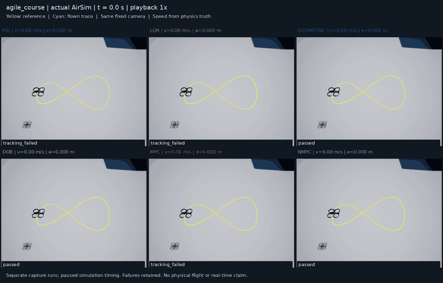

# IET Chapter 5: UAV Control Systems

A reproducible AirSim case study for conventional quadrotor control: **one simulation interface, six controller implementations, configurable trajectories and measured performance evaluation**. Each controller computes physical thrust and body moments through the same verified motor adapter.

## Watch the controllers track an agile 3D trajectory

[](results/examples/rigid_body_demo/comparison.mp4)

**GIF: 2× simulation speed. [Watch the MP4 at 1×](results/examples/rigid_body_demo/comparison.mp4).** Yellow is the reference; cyan is the actual flight path. Panels show measured speed, tracking error, acceptance and logged MPC fallback/RTI commands.

The reference is a **6 m wide, three-dimensional multi-harmonic figure eight with changing heading**, an 8.5 s traversal and 1 s holds at each end. Peak reference speed is **4.02 m/s**, with approximately 40° ideal thrust tilt. These are genuine AirSim scene captures: 528 original frames have verified hashes and synchronized physics timestamps. The six demonstration runs contain three passes and three retained failures; they are separate from the evaluation matrix below.

## Measured results

The latest [42-run evaluation](docs/rigid_body_nmpc_results.md) compares linear MPC, rigid-body nonlinear MPC and geometric control on seven trajectories with two repeats: **40 passes and two retained linear-MPC failures on the aggressive task**. All 14 NMPC runs pass, with zero fallback.

| Controller | Aggressive traversal RMS, two repeats | Outcome |
|---|---:|---|
| Linear MPC | 331.756 / 332.115 mm | Both fail; 231 explicit LQR fallback activations per run |
| Rigid-body NMPC | 3.837 / 3.840 mm | Both pass; zero fallback; peak error ≈8.1 mm |
| Geometric | 15.297 / 15.297 mm | Both pass |

The linear baseline retains its near-hover model and conservative prediction envelope. NMPC uses quaternion rigid-body dynamics, motor lag and coupled physical motor constraints. Model, weights, update intervals and horizons also differ, so these results compare the implemented configurations rather than establish a ranking of controller families. All seven NMPC repeat pairs pass the declared repeatability check; the aggressive linear-MPC pair fails it.

acados generates C solvers and uses SQP-RTI, HPIPM/BLASFEO, partial condensing and warm starts. In a separate measured-feedback replay, default RTI versus SQP native-solver p95 is **2.46 versus 4.37 ms**; complete-call p95 is **7.29 versus 8.42 ms**. RTI performs one SQP step rather than solving to the same convergence tolerance. See the [timing ablations, residuals and command differences](results/examples/acados_acceleration/REPORT.md).

Evaluation uses **paused simulation time**. Wall-time spikes are reported; real-time operation and physical flight are not established.

## Controllers and configuration

| ID | Implementation | Parameters |
|---|---|---|
| `pid` | [Cascaded position, attitude and rate PID](src/iet_ch5/controllers/pid/README.md) | [config.json](src/iet_ch5/controllers/pid/config.json) |
| `lqr` | [Near-hover linear state feedback / LQR](src/iet_ch5/controllers/lqr/README.md) | [config.json](src/iet_ch5/controllers/lqr/config.json) |
| `geometric` | [Geometric trajectory and attitude control](src/iet_ch5/controllers/geometric/README.md) | [config.json](src/iet_ch5/controllers/geometric/config.json) |
| `dob` | [Bounded force disturbance observer around geometric control](src/iet_ch5/controllers/dob/README.md) | [config.json](src/iet_ch5/controllers/dob/config.json) |
| `mpc` | [Constrained near-hover linear MPC, OSQP](src/iet_ch5/controllers/mpc/README.md) | [config.json](src/iet_ch5/controllers/mpc/config.json) |
| `nmpc` | [17-state quaternion rigid-body + motor-lag NMPC, acados](src/iet_ch5/controllers/nmpc/README.md) | [config.json](src/iet_ch5/controllers/nmpc/config.json) |

Each method owns its `controller.py`, `config.json` and parameter guide. All use the same state/reference contract, feedback, upward inertial/positive-thrust convention, physical allocator, experiment runner and evaluation. No built-in AirSim position or velocity controller is relabelled as a chapter algorithm.

```text
src/iet_ch5/
  simulation/              Common backend interface and AirSim adapter
  controllers/             pid/, lqr/, geometric/, dob/, mpc/, nmpc/
  trajectories/            Analytic references, time laws and JSON presets
  experiments/             Configuration, execution, publication and video
  evaluation/              Independent physics-truth metrics
  allocation.py            Shared physical thrust/moment-to-motor adapter
  runner.py                Common control loop and logging
configs/experiments/        Evaluation suites and runtime configuration
scripts/run_case_study.py   Unified list / plan / run / demo / publish CLI
results/examples/          Committed compact data, reports, figures and videos
```

## Install

Tested on Linux x86_64 with Python 3.10. Install the Python environment from the lockfile:

```bash
uv sync --extra dev --extra plots --extra mpc --locked
export OPENBLAS_NUM_THREADS=1 OMP_NUM_THREADS=1
PYTEST_DISABLE_PLUGIN_AUTOLOAD=1 .venv/bin/pytest -q
.venv/bin/ruff check src scripts tests
.venv/bin/python scripts/run_case_study.py list
```

Simulator integration tests skip unless a server is explicitly selected. Viewing the committed results and regenerating their figures does not require AirSim:

```bash
.venv/bin/python scripts/plot_case_study.py results/examples/rigid_body_mpc \
  --output results/runs/regenerated-figures
```

For **NMPC**, also install the optional dependencies and pinned native solver. CMake and GCC are required:

```bash
uv sync --extra dev --extra plots --extra mpc --extra nmpc --locked
.venv/bin/python scripts/install_acados.py
```

The installer builds acados v0.5.4 at a fixed source commit under ignored `.local/`, recording compiler and binary hashes. Run it after `uv sync`, including after later environment resynchronization. See the [native installation and model guide](docs/rigid_body_nmpc.md).

## Connect an isolated AirSim instance

Reuse an Unreal 4.27.2 / AirSim Blocks installation with the required telemetry extension. The [environment report](docs/environment_report.md) records the extension and verified simulator build; stock AirSim does not guarantee these custom APIs.

Create ignored `.local/environment.json` with `editor` (installed UE4Editor executable), `project` (Blocks.uproject), `airsim_root`, `host`, `port` and `vehicle` (`Chapter5`). Use a free dedicated RPC port matching the selected AirSim settings. Keep machine paths and endpoint details local.

```bash
.venv/bin/python scripts/launch_simulator.py \
  --local-config .local/environment.json \
  --settings configs/airsim-demo-settings.json \
  --local-output .local/ch5-simulator
# After Unreal finishes loading, verify the required APIs without commanding flight:
.venv/bin/python scripts/check_environment.py \
  --local-config .local/environment.json --output .local/capabilities.json
```

The launcher refuses an occupied RPC port. The `run` and `demo` commands below reset, arm and operate the selected simulator; use an exclusive instance. Each completed run finishes paused and disarmed.

## Run a trajectory or the evaluation suite

Seven [JSON trajectory presets](src/iet_ch5/trajectories/configs) provide analytic position, velocity, acceleration, jerk, snap and heading references:

| ID | Reference |
|---|---|
| `hover` | Fixed point |
| `transfer` | Smooth three-axis displacement |
| `circle` | Horizontal circle |
| `figure_eight` | Horizontal Gerono figure eight |
| `helix` | Circular ascent |
| `spatial_course` | 3D multi-harmonic figure eight with varying yaw |
| `agile_course` | Faster, wider spatial figure eight used in the GIF |

Preview the latest suite without connecting to a simulator, then run one controller/trajectory pair:

```bash
.venv/bin/python scripts/run_case_study.py plan \
  --suite configs/experiments/rigid_body_mpc.json \
  --output .local/rigid-body-plan.json
.venv/bin/python scripts/run_case_study.py run \
  --suite configs/experiments/rigid_body_mpc.json \
  --controller nmpc --trajectory agile_course --repeats 1 \
  --local-config .local/environment.json --exclusive-simulator \
  --output results/runs/my-nmpc
```

Use `--controller geometric` for a first flight without the optional acados build. To run the full **3 controllers × 7 trajectories × 2 repeats** evaluation and publish its compact results:

```bash
.venv/bin/python scripts/run_case_study.py run \
  --suite configs/experiments/rigid_body_mpc.json \
  --local-config .local/environment.json --exclusive-simulator \
  --output results/runs/my-rigid-body-matrix
.venv/bin/python scripts/run_case_study.py publish \
  --output results/runs/my-rigid-body-matrix \
  --destination results/runs/my-rigid-body-publication
```

Use new output directories. Runs freeze their exact source/configuration and retain failures; `--resume` only accepts a matching experiment. The [modular guide](docs/modular_case_study.md) explains custom trajectories, strict partial parameter overrides via `--controller-overrides`, runtime settings and additional robustness protocols. Tune on separate development tasks and freeze parameters before evaluation.

## Record your own six-controller comparison

With NMPC installed and the dedicated simulator checked:

```bash
.venv/bin/python scripts/run_case_study.py demo \
  --suite configs/experiments/rigid_body_mpc.json \
  --controller all --trajectory agile_course \
  --local-config .local/environment.json --exclusive-simulator \
  --output results/runs/my-six-controller-demo
.venv/bin/python scripts/run_case_study.py publish \
  --output results/runs/my-six-controller-demo \
  --destination results/runs/my-six-controller-video
```

Publication generates synchronized MP4/GIF comparisons from actual scene images and checks frame hashes, physics timestamps and camera poses. Capture runs are separate from benchmark timing. `--controller` and `--trajectory` also accept multiple IDs; a video group must contain one trajectory and one run per controller.

## Evidence and reproducibility

| Dataset | Measured outcome | Report |
|---|---|---|
| Latest rigid-body comparison | 42 runs; 40 passes, 2 retained failures | [Results and interpretation](docs/rigid_body_nmpc_results.md) · [All-run report](results/examples/rigid_body_mpc/REPORT.md) |
| Six-controller scene demonstration | 6 separate captures; 3 passes, 3 retained failures | [Media validation](results/examples/rigid_body_demo/media_validation.json) · [MP4](results/examples/rigid_body_demo/comparison.mp4) |
| acados computation replay | 438 measured records × 3 repeats per variant | [Timing report](results/examples/acados_acceleration/REPORT.md) · [Portable replay inputs](results/examples/acados_acceleration/REPLAY.md) |
| Earlier modular comparison | 70 runs; 64 passes, 6 retained failures | [Results](docs/modular_results.md) |
| Original robustness case study | 51 runs; 47 passes, 4 retained mismatch failures | [Case study](docs/case_study.md) |

These are distinct datasets with their own frozen configurations and provenance. The latest numerical source is `99515454ff0c69bce66f4a8f9ca6af5989057d25`; later commits add analysis, media and documentation. Compact truth samples, configurations, results and figures are committed. Full raw logs/images remain in local checksummed archives identified by each dataset's `full_archive.json`; an external raw-data upload is not claimed.

Earlier [cruise figure-eight](docs/figure_eight_cruise.md), [original figure-eight](docs/figure_eight_demo.md) and [circular](docs/trajectory_demo.md) demonstrations remain available.

For equations and adaptation history, see [model and conventions](docs/model_and_conventions.md), [controller mapping](docs/controller_mapping.md), [experiment protocol](docs/experiment_protocol.md), [third-party notices](THIRD_PARTY_NOTICES.md) and the [source/licence manifest](docs/source_manifest.json). Implementation scope and handoff are recorded in the [requirements](docs/IMPLEMENTATION_REQUIREMENTS.md), [upstream candidates](docs/UPSTREAM_CANDIDATES.md) and [current handoff](docs/IMPLEMENTATION_HANDOFF.md).
