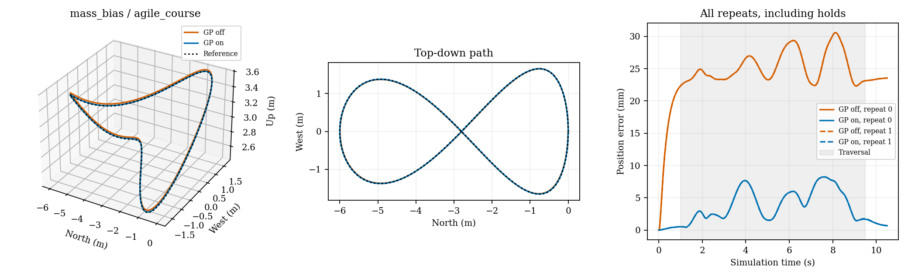
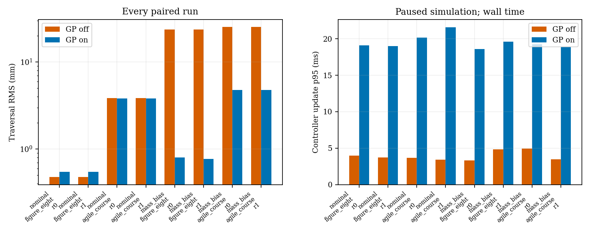

# Chapter 5.4.6: learned force residual in AirSim NMPC

The completed case study isolates one change: a frozen Gaussian-process force residual inside the existing rigid-body NMPC prediction model. In the tested controller-mass-mismatch condition, learning reduces trajectory error substantially. With an already accurate nominal model it offers no consistent tracking improvement and increases computation. Both findings are retained.

## Design and execution

Numerical/model/configuration freeze: `8e9b2161496b93f7e09c28e6aa8032563750df65`. Later publication changes only improve plotting, input-hash checks and censored-result handling; no closed-loop controller, training label, GP parameter or experiment setting is changed from the freeze.

The same AirSim Blocks plant, shared runner, NWU/FLU state feedback and physical motor allocation are used throughout. Both variants receive the same atomic simulator physics-truth feedback; archived physics samples provide evaluation truth. No state-estimator validation is claimed. Before learning, the unchanged NMPC passed actual transfer and agile-course baseline flights. The original AirSim source/binary/diff hashes were checked before and after evaluation and remained unchanged.

Ten additional flights collect training and validation data: transfer, circle and helix for training; separate figure-eight and spatial-course flights for prediction validation. Each is flown under nominal parameters and controller mass bias. Six flights train two condition-specific GP models; four held-out flights validate them. The two models use 64 support observations each and are frozen before closed-loop evaluation. No upstream dataset or pretrained weight is used.

The final matrix is **2 conditions × 2 trajectories × 2 repeats × 2 residual settings = 16 actual AirSim flights**. Each pair has identical verified initial position/velocity/attitude/body rate, physical and controller parameters, reference, horizon, cost, discretization, state feedback, motor constraints, allocator and actuator lag. Only `residual.enabled` changes. Repeat 0 runs off/on; repeat 1 runs on/off. All pairs are checked during publication.

Nominal conditions use the verified plant mass. Mass bias changes only the controller's assumed mass to 1.1 times the plant value; physical mass and assumed inertia are unchanged. No external force or wind is injected. A model-discrepancy label must not be interpreted as measured aerodynamic force.

The ordinary figure eight evaluates traversal over [1, 11] s of a 12 s flight. The aggressive spatial figure eight evaluates [1, 9.5] s of a 10.5 s flight, with 4.02 m/s peak reference speed and varying heading. RMS uses independent physics truth on the common endpoint-inclusive time grid. Peak/constraints include initial/final holds. Acceptance limits remain 0.10 m nominal-trajectory RMS and 0.15 m aggressive-trajectory RMS.

## Tracking results

| Condition | Trajectory | GP off RMS, two repeats (mm) | GP on RMS, two repeats (mm) | Interpretation |
|---|---|---:|---:|---|
| Nominal | figure eight | 0.475 / 0.475 | 0.548 / 0.548 | Slight degradation; +0.073 mm mean absolute difference |
| Nominal | agile spatial course | 3.836 / 3.836 | 3.832 / 3.833 | Essentially unchanged; approximately 0.1% difference |
| Controller mass +10% | figure eight | 23.732 / 23.732 | 0.797 / 0.773 | Mean RMS reduction 96.7% |
| Controller mass +10% | agile spatial course | 25.384 / 25.384 | 4.770 / 4.767 | Mean RMS reduction 81.2% |

**All 16 flights pass tracking acceptance and complete the common evaluation interval.** There is no safety/collision abort, motor saturation, declared task-level speed/tilt violation or geometric fallback. All 7,504 optimization calls return accepted acados status 0; SQP-RTI status 0 does not imply a fully converged nonlinear optimum. All eight repeatability checks pass the predeclared 20 mm maximum position-difference bound; the largest measured difference is about 0.493 mm. Two repeats are a reproducibility check, not a powered statistical comparison.

[Every paired flight and full metrics](../../results/examples/learning_case_study/REPORT.md) · [Requested/applied thrust and motor commands](../../results/examples/learning_case_study/figures/mass_bias_agile_course_inputs.png)

## Prediction validation and computation cost

On independent mass-bias flights, 0.96 s open-loop position prediction RMSE drops from approximately 0.413 m to 0.0112 m (figure eight) and 0.0137 m (spatial course). Nominal prediction slightly degrades: 0.01056 to 0.01115 m and 0.00482 to 0.00496 m. One-step position/velocity errors, residual-label errors and full horizon error curves remain in the [prediction report](../../results/examples/learning_prediction/REPORT.json). Those rollouts replay measured future commanded inputs, start from measured initial states, and do not correct subsequent states from truth. Overlapping rollout windows are not independent trials.

Across individual closed-loop flights, complete optimization-update p95 is **3.34–4.96 ms with GP off** and **18.57–21.58 ms with GP on**. Native solver p95 is **1.14–1.80 ms** and **9.34–10.82 ms**, respectively. Complete-update maxima reach 57.3 ms off and 69.5 ms on. These are measured wall times on this host, including Python stage updates/extraction. Preparation/code generation occurs before evaluation and is separately recorded. The GP adds meaningful computational cost despite using generated C and acados RTI.

Paused stepping allows evaluation despite wall-time overruns. It does not validate real-time deployment. The results support residual compensation for this recorded mass bias; they do not establish general aerodynamic learning, cross-condition model transfer, uncertainty calibration, online adaptation, stability or physical-flight performance.

## Reproduce and inspect

- [Model equations, labels, split, configuration and tested commands](GP_NMPC.md).
- [Initial AirSim baseline evidence](L0_BASELINE.md).
- [Ten-flight compact dataset and raw-log hashes](../../results/examples/learning_dataset/manifest.json).
- [Frozen model versions](../../models/learning/manifest.json).
- [Final paired protocol and source fingerprint](../../results/examples/learning_case_study/protocol.json).
- [Local raw archive receipt](../../results/examples/learning_case_study/full_archive.json): all 28 new baseline/acquisition/evaluation flights; no external upload is claimed.
- [Assessment of all 12 supplied upstream projects](UPSTREAM_ASSESSMENT.md), including action semantics, retraining needs and licence restrictions.

The original conventional-controller datasets, videos and configurations remain preserved. Other learning algorithms are assessed, not claimed as implemented or experimentally reproduced. The next comparable dynamics extension would be a separately trained small neural residual with the same flight split and NMPC ablation.
