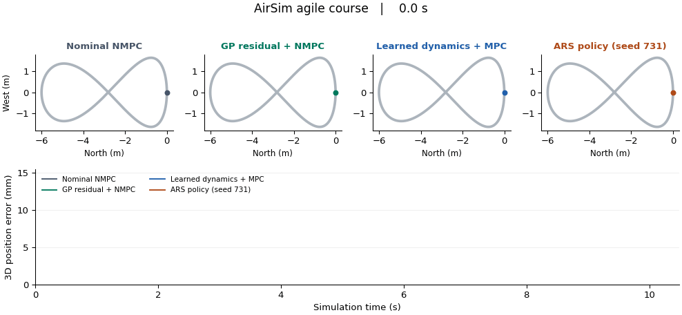

# Learning-based quadrotor tracking

The replay compares nominal NMPC, GP residual NMPC, learned nonlinear dynamics inside MPC, and a reward-trained ARS policy (seed 731). The lower panel follows 3D position error in millimetres.

Run `python examples/learning_comparison/animate_learning.py` from the repository root in the chapter Python environment to regenerate the animation from the committed flight logs.

[Training, evaluation and results for all three seeds](../../results/examples/learning_retrained/README.md) · [Paired GP residual experiment](../../results/examples/learning_case_study/REPORT.md)
