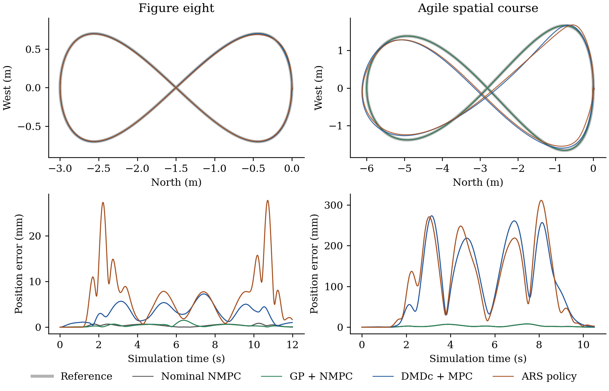

# Learning a flight model and learning a tracking policy

Both new controllers send collective thrust and body moments through the Chapter 5 allocator to the same AirSim Blocks quadrotor. The published nominal and GP NMPC flights supply the two existing references. All eight new evaluation runs used the archived nominal task configuration, initial kinematics, physical parameters, truth feedback and 12 ms control interval. No test trajectory was used to train or choose a checkpoint.

| Method | Figure eight, traversal position RMS | Agile spatial course, traversal position RMS |
|---|---:|---:|
| Nominal NMPC (archived) | 0.48 mm | 3.84 mm |
| GP residual + NMPC (archived) | 0.55 mm | 3.83 mm |
| Identified local dynamics + MPC | 3.95 mm | 155.27 mm |
| Direct wrench policy trained by ARS | 9.55 mm | 159.02 mm |

The new methods each completed both flights twice. Each passed the ordinary figure-eight tolerance (100 mm) and missed the agile-course tolerance (150 mm). The two repeats of each new test produced identical traversal RMS to the reported precision. These are deterministic tracking demonstrations with one trained policy seed.

## What the reader can see

The first route learns a local affine transition for all 16 coordinates (position, velocity, Euler attitude, body angular velocity and four applied-wrench channels). Three excitation flights on circle, helix and transfer trajectories provide aligned motor inputs and state transitions. Centring the collective about hover and assuming translation invariance reduces the fit dimension. Full-rank least squares on scaled snapshot pairs implements a full-order, affine DMDc-style predictor. No nominal rigid-body acceleration is added. Absolute position is carried forward explicitly. Every flight control tick, MPC optimises 12 six-tick input blocks against the learned model and a reference preview. Rotor bounds couple all four wrench channels. On archived held-out nominal NMPC logs, 0.72 s command-replay endpoint position RMS is 20 mm on the eight and 313 mm on the agile course. These are open-loop prediction errors in nonoverlapping windows; the table reports a different, closed-loop measure.

The second route trains a structured linear policy using paired augmented random search (ARS) in that identified simulator. The observation is a 12-component tracking error with near-hover reference tilt/rates derived from the commanded acceleration and jerk. A fixed collective feedforward and a sign-structured hand-initialised feedback matrix define the policy class. ARS changes 12 gain magnitudes against position, velocity and command penalties over 90 batches of 300-step rollouts. At evaluation the frozen policy produces the full wrench directly. It needs neither an online predictor nor a tracking optimiser. The shared allocator converts wrench into motor commands. A separate zero-training ablation records the initial policy's flight results in the two initial JSON files. The new tests compare whole architectures, with different reference usage and training assumptions.

## Reproduce

From the repository root, with the documented dependencies and a dedicated, capability-checked AirSim Blocks instance, run the following commands in order. The environment file identifies that instance. Use fresh output directories. The compact snapshots, weights and measured flight traces in this folder also support analysis without Unreal. Tested with NumPy 2.2.6, SciPy 1.15.3, OSQP 1.0.5 and Matplotlib 3.10.7.

~~~bash
export OPENBLAS_NUM_THREADS=1 OMP_NUM_THREADS=1 PYTHONPATH="$PWD/src"
d=examples/learning_comparison
out=.local/comparison-reproduction
mkdir -p "$out/models"
python "$d/excitation.py" .local/environment.json "$out/collection"
python "$d/model.py" "$out/collection" "$out/models/model.npz"
python "$d/train_policy.py" "$out/models/model.npz" "$out/collection/circle/metadata.json" "$out/models/policy.npz"
python "$d/evaluate.py" .local/environment.json "$out/models" "$out/evaluation"
python "$d/initial_policy.py" .local/environment.json "$out/initial"
python "$d/publish.py" "$out/collection" "$out/evaluation" "$out/models"
~~~

Algorithm sources are [Proctor, Brunton and Kutz, Dynamic Mode Decomposition with Control](https://doi.org/10.1137/15M1013857), the [PyDMD DMDc implementation](https://github.com/PyDMD/PyDMD/blob/024464ff667e4b0226f9ecbe933bc67f3fe21e81/pydmd/dmdc.py), and [Mania, Guy and Recht, ARS](https://github.com/modestyachts/ARS/tree/4c8e24e0a99cf811030e90680fc29eb94fae8cdd). These examples implement the algorithms locally for the chapter's vehicle and data contract. No upstream code or pretrained policy was copied.
