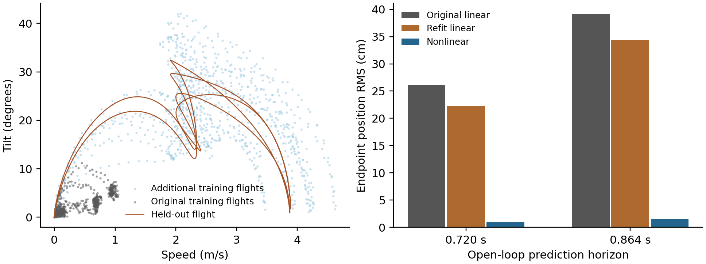
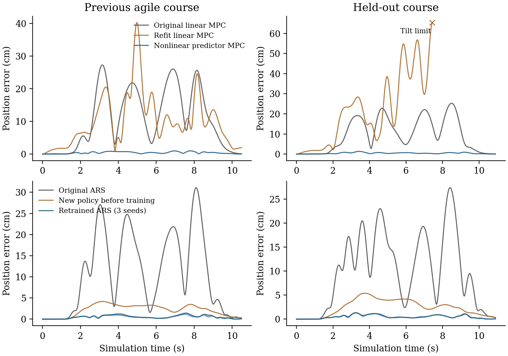

# Wider-envelope flight identification and policy retraining

The repeated AirSim experiment asks two separate questions. Does a learned predictor describe the vehicle over the horizon used by the controller? Does a tracking policy trained in that predictor transfer to the original AirSim plant?

Six new excitation flights extend the original circle, helix and transfer dataset. A geometric controller follows turning, climbing and descending references with changing heading while small independently varied wrench inputs excite the vehicle. The learning dataset consists of nine complete nominal flights. One additional flight supplies independent command-replay validation. A previously used agile course remains diagnostic. One new parameter combination from the same spatial trajectory family is reserved for final testing. The experiment does not cover other vehicles, sensors, winds or trajectory families.

The original training envelope reached 1.05 m/s and 11.2 degrees of tilt. The expanded set reached 4.63 m/s and 42.1 degrees. These are observed marginal maxima; the multivariate distribution is not uniform.

## Model and controller comparisons

The wider-data linear fit uses the original centred 16-state DMDc-style model and the original MPC. A second model learns increments of all 16 states by regression on physically motivated features, including rotor thrust projected along the actual thrust axis, Euler kinematic terms and angular-rate products. It is a structured nonlinear identification model. Validation replays measured inputs in nonoverlapping windows, without resetting the predictor inside a window. At the 0.864 s control horizon, 12 validation windows give position endpoint RMS of 0.391 m for the original model, 0.344 m for the refitted linear model and 0.0153 m for the nonlinear model.

A new preview controller uses orientation and thrust references computed from the desired translational acceleration and heading, plus angular-rate and torque references derived from the planned trajectory. Both the wider-data linear and nonlinear models run through this same preview controller for a matched predictor comparison. The nonlinear controller uses a local time-varying approximation along the reference. All MPC variants use a 12-block horizon, 6 control ticks per block, and physical rotor limits. All evaluated controllers use simulated truth feedback, a common motor allocator and paused stepping.

## Policy training and ablations

ARS adjusts 12 signed feedback gains in a structured tracking policy. The initial policy already has geometric reference feedforward. Tracking-error position and velocity channels are expressed relative to desired heading. Feedforward and the observation function are shared between training and evaluation. Infeasible action requests terminate a surrogate training rollout with a penalty. The deployed system uses the common bounded allocator. Training uses 135 batches of paired 3.6 s rollouts per seed, the frozen nonlinear model, and only the nine training references. All three seeds are evaluated without selecting the best run. The training method is derivative-free policy search for this parameterisation. The initial-policy ablation isolates the contribution of training relative to the improved feedforward.

## Measured traversal position RMS

| Controller | Previous agile course | Held-out course |
|---|---:|---:|
| Original DMDc MPC | 155.27 mm | 138.65 mm |
| Refit DMDc, original MPC | 142.59 mm | Tilt abort at 7.43 s |
| Refit DMDc, new preview controller | 85.84 mm | Tilt abort at 5.23 s |
| Nonlinear predictor, same new preview controller | 5.56 mm | 6.00 mm |
| Original ARS | 159.02 mm | 139.07 mm |
| Revised policy before training | 28.02 mm | 32.46 mm |
| Retrained ARS, seed 731 | 7.46 mm | 6.67 mm |
| Retrained ARS, seed 732 | 6.31 mm | 6.62 mm |
| Retrained ARS, seed 733 | 6.42 mm | 6.65 mm |
| Geometric controller | 15.31 mm | 17.60 mm |

The two interrupted test flights exceeded the common 1.1 rad tilt abort limit; their incomplete trajectories are excluded from full-traversal RMS. All six trained-policy flights and both nonlinear-predictor flights completed the common interval. Each weight set was flown once per route.

## Data and reproduction

The [protocol](protocol.md) identifies the split and metrics. The [prediction results](validation.json), [policy transfer check](transfer.json), [per-flight metrics](tracking.json) and [weight hashes](frozen.json) correspond to separate calculations. Compact training states/actions, validation samples, individual flight traces and raw-log hashes are included. Each training state comprises position, velocity, xyz Euler angles, body rates and four hover-centred telemetry wrench channels. The action is the realised allocation request in hover-centred wrench coordinates. Compare policy training and simulated flight using traversal-only 3-D, time-weighted position RMS. AirSim wall-clock timing is outside the experimental claim.

From the repository root, activate the chapter environment, set PYTHONPATH to the source directory and select single-thread BLAS. The following example assumes the original three acquisition flights under .local/identification and a dedicated, capability-checked AirSim instance described in .local/environment.json. Use fresh raw/output directories.

~~~bash
export PYTHONPATH="$PWD/src" OPENBLAS_NUM_THREADS=1 OMP_NUM_THREADS=1
d=examples/learning_comparison
raw=.local/new-wide-run
out=$raw/results
mkdir -p "$out"
python "$d/collect_wide.py" .local/environment.json "$raw/collection"
python "$d/wide_model.py" "$raw/collection" "$out"
python "$d/wide_train.py" "$out"
python "$d/wide_evaluate.py" .local/environment.json "$out" "$raw/evaluation"
python "$d/wide_report.py" "$raw" "$out"
python "$d/wide_transfer.py" "$raw/evaluation" "$out"
python "$d/coverage_plot.py" "$raw" "$out"
~~~

To rerun policy training alone without Unreal, copy vehicle.json and nonlinear.npz into a fresh directory and run wide_train.py with that directory. A second training execution regenerated the same policy arrays and reward histories for all three published seeds.
